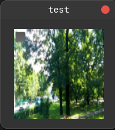
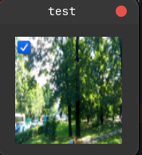

# GTKMM Media Selector Widget

Media selector widget that helps create on a single widget a
control to preview media and selection (checkbutton).

It supports:
* GIF Images (by using [gtkmm_gif_image](https://github.com/iscluis06/gtkmm_gif_image))
* Static Image (by using Picture widget)
* Video (by using mediafile and picture widget)

### Example (mp4 video)



### Requirements

* gtkmm 4 (GTK binding for C++)
* pkgconfig (development only)

```shell
apt install pkgconf-bin pkgconf libgtkmm-4.0-0 libgtkmm-4.0-dev
```


If you find this useful, please consider making a donation. Thanks!<br><br>
[](https://www.buymeacoffee.com/iscluis06)